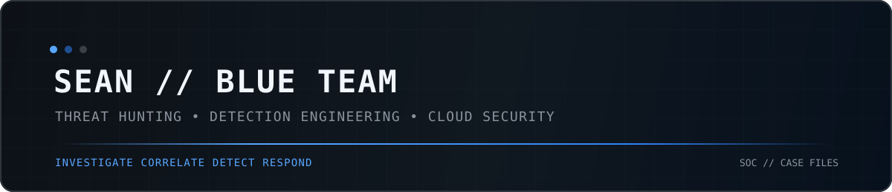

  

<h1 align="center">Hey, I'm Sean</h1>

<h3 align="center">Threat Hunter & blue team investigator</h3>

  
  

## Brief Intro

My work sits where threat hunting, detection, and incident investigation meet. I build hands on security labs that generate real telemetry, uncover security gaps, and turn suspicious activity into evidence backed investigations. That work spans SIEM analysis, endpoint telemetry, network forensics, incident response, and cloud security.

### Currently focused on

## 🔎 Featured Case Files

### 01 Network Detection & Packet Forensics

**Raw packets to detection engineering and automated triage**

Reconstructed suspicious traffic from PCAPs, correlated findings with Zeek and Suricata, identified a detection coverage gap, wrote a custom IDS rule, validated it against the same preserved evidence, and built TraceHound to automate first pass PCAP triage.

[Open Case File](https://github.com/Seanfrvr/Network-Detection-and-Packet-Forensics-home-lab)

### 02 Azure Identity Detection & Correlation

**Entra telemetry to a tuned Sentinel incident**

Built an Azure identity investigation around privilege assignment and user creation activity, reconstructed the sequence in KQL, converted the relationship into a scheduled Sentinel analytic rule, deployed it through the Microsoft SecurityInsights REST API, replayed fresh activity, found duplicate alerting, tuned the rule, and validated one clean alert and one incident.

[Open Case File](https://github.com/Seanfrvr/Azure-Identity-Detection-Correlation-Home-Lab)

### 03 Detection Engineering & Response

**Live endpoint telemetry through detection and SOAR response**

Built a self contained SOC lab with Sysmon, Wazuh, Atomic Red Team, Shuffle, VirusTotal and Slack. Tested credential access, persistence and PowerShell activity, investigated raw telemetry, identified detection logic gaps, recovered broken services during the work, and validated the response pipeline end to end.

[Open Case File](https://github.com/Seanfrvr/Detection-Engineering-and-Response-HL)

### 04 Threat Hunting with Splunk

**Threat hunting across endpoint, authentication and cloud logs**

Investigated encoded PowerShell activity, Linux SSH brute force behaviour and AWS CloudTrail identity activity in Splunk using BOTSv3. The work focuses on SPL construction, payload decoding, IoC handling, cloud identity analysis and evidence backed defensive recommendations.

[Open Case File](https://github.com/Seanfrvr/Threat-hunting-with-splunk-HL)

## 🧰 Investigation Stack

> Tools and platforms I have strong knowledge of, backed by practical use across my case files. Each project shows how I apply them during investigations.

### SIEM & Investigation

### Endpoint & Detection

### Network Detection & Forensics

### Cloud Security

### Response & Enrichment

## More Work

### Google Cloud Data Breach Incident Response

Investigated and remediated a cloud breach scenario using Security Command Center, Compute Engine, Cloud Storage and VPC Firewall. The work covered containment, hardened rebuild, storage access control, least privilege network access and PCI DSS aligned remediation.

[Open Project](https://github.com/Seanfrvr/gcp-data-breach-incident-response)

## What I care about

I care about what the evidence can actually prove. I try to separate suspicious behaviour from confirmed impact, telemetry gaps from detection gaps, and tool output from analyst conclusion. My projects are built around that mindset.

  
  

